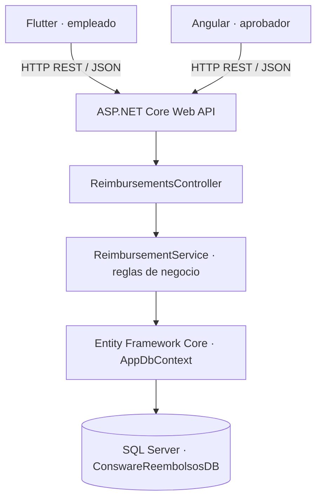
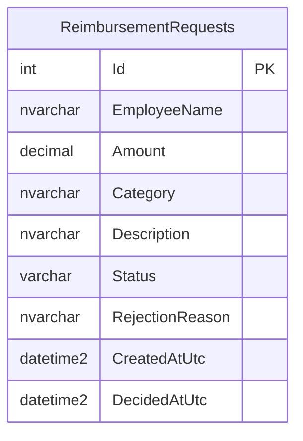
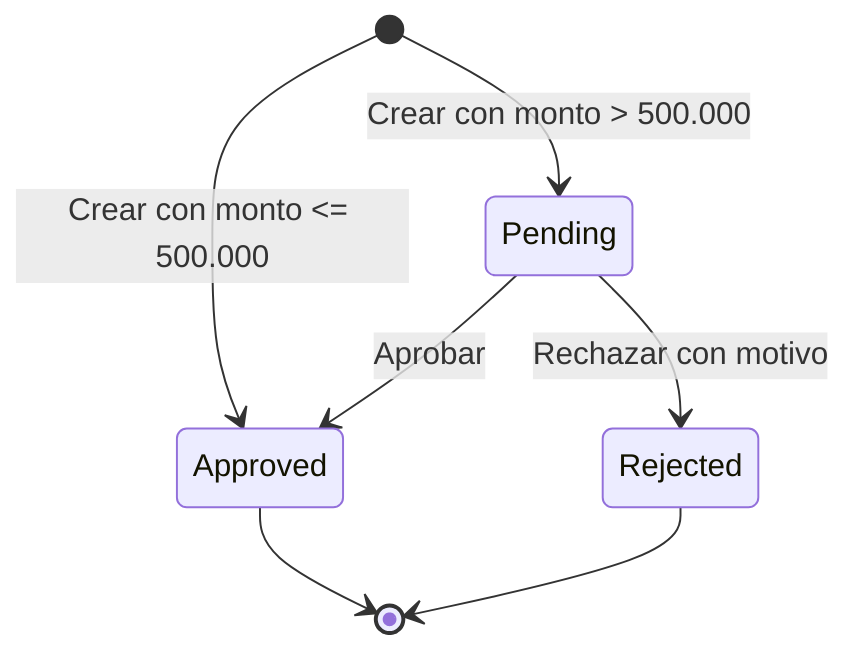
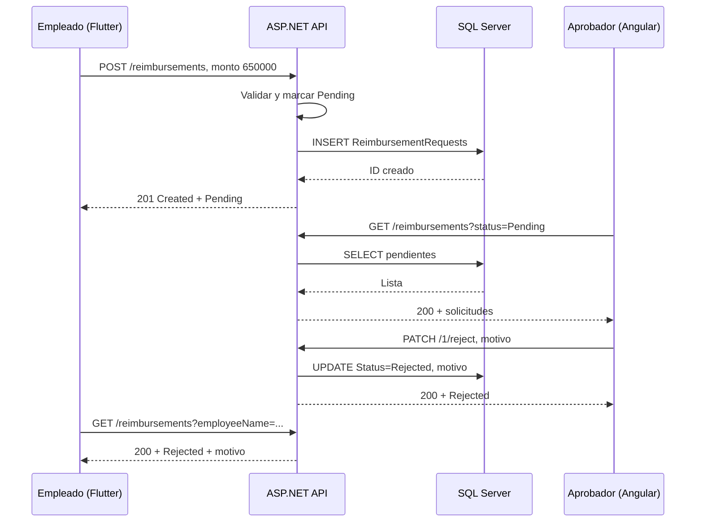

# CONSWARE — Sistema de Reembolso de Gastos

**Guía técnica de arquitectura, base de datos e implementación**  
**Prueba técnica Fullstack:** ASP.NET Core · Entity Framework Core · SQL Server · Flutter · Angular  
**Versión:** 2.0 — SQL Server · **Fecha:** 29 de octubre de 2026  
**Estado:** documento de diseño e implementación; el código del sistema aún debe desarrollarse y probarse.

> **Objetivo de este documento.** Tener un plano único y ejecutable para desarrollar el MVP durante las cuatro horas de la prueba, explicarlo durante la entrevista y evitar sobreingeniería. La base es el enunciado «Prueba Técnica · Desarrollador Fullstack» de Consware (cinco páginas) y su versión HTML. Donde se indica **Exigido**, proviene del enunciado; donde se indica **Decisión del proyecto**, es una propuesta técnica nuestra.

---

## 0. Resumen ejecutivo: qué vamos a construir

El sistema permite que un empleado registre un gasto y consulte su estado. Un aprobador revisa los gastos de alto valor desde una página web. Una única API centraliza la lógica de negocio y guarda la información en una base de datos SQL Server.

| Parte | Entregable | Prioridad | Tiempo sugerido por Consware |
|---|---|---|---|
| 1 | API REST con ASP.NET Core y SQL Server | Crítica | Aproximadamente 90 minutos |
| 2 | App Flutter para empleados | Crítica | Aproximadamente 90 minutos |
| 3 | Panel Angular para aprobador | Complementaria | Aproximadamente 60 minutos |

**Política central exigida:**

- **Monto ≤ $500.000 COP:** se aprueba automáticamente al crear la solicitud.
- **Monto > $500.000 COP:** queda en estado **Pendiente**, a la espera de decisión.
- **Rechazo:** siempre exige un motivo escrito y no vacío.
- **Estado final:** una solicitud aprobada o rechazada nunca vuelve a cambiar de estado.
- **Persistencia:** debe ser una base de datos **SQL real**, no una lista en memoria.

**Decisión del proyecto:** utilizar **SQL Server**, porque está instalado y accesible desde SSMS en el equipo de desarrollo. El enunciado permite SQL Server y no exige SQLite. El servidor mostrado en SSMS es `JEREMY\MSSQLSERVER2026` y la cuenta conectada parece ser `Jeremy\Jeremy`; se utilizará autenticación integrada de Windows **si la API corre con esa cuenta y tiene permisos**.

**Qué NO construiremos:** autenticación, empleados administrables, carga de recibos, auditoría empresarial, microservicios, Docker, nube, Redis, colas, dashboards complejos, notificaciones ni CI/CD. No forman parte del enunciado y consumirían el tiempo de las funcionalidades obligatorias.

---

## 1. Arquitectura general

### 1.1 Vista de componentes



**Interpretación:** los clientes **nunca** acceden directamente a SQL Server. Flutter crea y consulta solicitudes; Angular consulta las pendientes y envía decisiones; ASP.NET Core valida, decide y persiste.

### 1.2 Responsabilidad de cada capa

| Componente | Responsabilidad concreta |
|---|---|
| Flutter | Capturar monto/categoría/descripción, presentar solicitudes del empleado, mostrar errores de red. |
| Angular | Filtrar solicitudes y ejecutar aprobación/rechazo con motivo. |
| Controller | Exponer rutas HTTP, validar el formato de entrada, devolver códigos y mensajes correctos. |
| DTOs | Contratos de entrada y salida en JSON; evitar exponer directamente entidades EF. |
| Service | Contener la política de $500.000, transiciones de estado y reglas de validación. |
| DbContext | Consultas, escritura de registros, mapeo e índices mediante EF Core. |
| SQL Server | Persistencia relacional y durable del sistema. |

### 1.3 Por qué un monolito pequeño

Existe un solo dominio funcional (reembolsos), una sola base y poco tiempo. Separar Controller, Service, DTOs y Data hace el código legible **sin** crear cinco proyectos .NET ni introducir una arquitectura de microservicios. La aplicación puede crecer después sin reescribir el principio central: las reglas permanecen en el backend.

---

## 2. Estructura definitiva de carpetas

```text
consware-reembolsos/
├── backend/
│   └── Consware.Reimbursements.Api/
│       ├── Controllers/
│       │   └── ReimbursementsController.cs
│       ├── Data/
│       │   └── AppDbContext.cs
│       ├── DTOs/
│       │   ├── CreateReimbursementDto.cs
│       │   ├── RejectReimbursementDto.cs
│       │   └── ReimbursementResponseDto.cs
│       ├── Models/
│       │   ├── ReimbursementRequest.cs
│       │   └── ReimbursementStatus.cs
│       ├── Services/
│       │   ├── IReimbursementService.cs
│       │   └── ReimbursementService.cs
│       ├── Migrations/                 # Generada por EF Core
│       ├── Properties/                  # Puede incluir launchSettings.json
│       ├── Program.cs
│       ├── appsettings.json
│       └── Consware.Reimbursements.Api.csproj
├── mobile/
│   ├── lib/
│   │   ├── config/api_config.dart
│   │   ├── models/reimbursement.dart
│   │   ├── services/reimbursement_api_service.dart
│   │   ├── screens/create_reimbursement_screen.dart
│   │   ├── screens/my_reimbursements_screen.dart
│   │   ├── widgets/status_badge.dart
│   │   └── main.dart
│   └── pubspec.yaml
├── web/
│   ├── src/app/
│   │   ├── models/reimbursement.model.ts
│   │   ├── services/reimbursement.service.ts
│   │   ├── features/approvals/
│   │   │   ├── approvals.component.ts
│   │   │   ├── approvals.component.html
│   │   │   └── approvals.component.scss
│   │   ├── app.config.ts
│   │   └── app.routes.ts
│   └── package.json
├── .gitignore
└── README.md
```

**Reglas organizativas:** una clase/función con una responsabilidad clara; tipos C# en `PascalCase`, variables en `camelCase`; archivos Dart en `snake_case`; nombres HTTP en minúsculas; **no** poner validación de negocio crítica dentro de widgets o componentes.

---

## 3. Base de datos: SQL Server

### 3.1 Nombre y servidor

| Parámetro | Valor de desarrollo |
|---|---|
| Motor | Microsoft SQL Server |
| Instancia observada | `JEREMY\MSSQLSERVER2026` |
| Base nueva | `ConswareReembolsosDB` |
| Conexión | Autenticación Windows integrada, si coincide con la de SSMS |
| ORM | Entity Framework Core, proveedor SQL Server |
| Creación del esquema | **Migraciones EF Core**, no scripts manuales en paralelo |

**Importante:** `JEREMY\MSSQLSERVER2026` es el nombre de una instancia local, **no** una dirección portable. En otro equipo el evaluador deberá sustituir `Server=` por el nombre de su instancia o configurar una instancia de SQL Server accesible. No es necesario desplegar SQL Server en Internet.

### 3.2 Modelo entidad-relación simplificado

**Decisión del proyecto:** una sola tabla `ReimbursementRequests`. El enunciado permite identificar al empleado por un nombre fijo y no exige login; por eso `EmployeeName` será texto, **sin** tabla `Users` ni clave foránea. Las categorías también serán texto controlado por la interfaz.



### 3.3 Diccionario de datos

| Columna | C# | SQL Server | Regla de negocio / restricción |
|---|---|---|---|
| `Id` | `int` | `INT IDENTITY(1,1)` | Clave primaria. |
| `EmployeeName` | `string` | `NVARCHAR(100)` | Obligatoria; se usará `Empleado Demo` o selección simple. |
| `Amount` | `decimal` | `DECIMAL(18,2)` | Obligatorio, mayor que 0. Montos expresados en COP. |
| `Category` | `string` | `NVARCHAR(60)` | Obligatoria, no solo espacios. |
| `Description` | `string` | `NVARCHAR(500)` | Obligatoria, no solo espacios. |
| `Status` | `enum` | `VARCHAR(16)` | `Pending`, `Approved` o `Rejected`. |
| `RejectionReason` | `string?` | `NVARCHAR(500) NULL` | Obligatorio cuando el estado es `Rejected`. |
| `CreatedAtUtc` | `DateTime` | `DATETIME2` | Fecha de creación en UTC. |
| `DecidedAtUtc` | `DateTime?` | `DATETIME2 NULL` | Fecha de aprobación/rechazo; nula si sigue pendiente. |

**Por qué `DECIMAL(18,2)` ahora:** SQL Server soporta de forma nativa un decimal fijo adecuado para valores monetarios. En Flutter se puede capturar el monto en pesos sin centavos mediante un campo numérico; en el backend el tipo será `decimal`. Para la prueba lo esencial es comparar correctamente `500000m` y persistir los valores.

### 3.4 SQL de referencia — no ejecutar si se utilizarán migraciones

```sql
-- ESQUEMA DE REFERENCIA. La fuente real será EF Core Migrations.
CREATE TABLE dbo.ReimbursementRequests (
    Id INT IDENTITY(1,1) NOT NULL PRIMARY KEY,
    EmployeeName NVARCHAR(100) NOT NULL,
    Amount DECIMAL(18,2) NOT NULL,
    Category NVARCHAR(60) NOT NULL,
    Description NVARCHAR(500) NOT NULL,
    Status VARCHAR(16) NOT NULL,
    RejectionReason NVARCHAR(500) NULL,
    CreatedAtUtc DATETIME2 NOT NULL,
    DecidedAtUtc DATETIME2 NULL,
    CONSTRAINT CK_Reimbursements_Amount CHECK (Amount > 0),
    CONSTRAINT CK_Reimbursements_Status CHECK
        (Status IN ('Pending', 'Approved', 'Rejected')),
    CONSTRAINT CK_Reimbursements_RejectionReason CHECK
        (Status <> 'Rejected' OR
         (RejectionReason IS NOT NULL
          AND LEN(LTRIM(RTRIM(RejectionReason))) > 0))
);
CREATE INDEX IX_ReimbursementRequests_Status
    ON dbo.ReimbursementRequests(Status);
CREATE INDEX IX_ReimbursementRequests_EmployeeName
    ON dbo.ReimbursementRequests(EmployeeName);
```

El script expresa las reglas de diseño y **no** sustituye la migración. La validación funcional continúa siendo responsabilidad del servicio ASP.NET; las restricciones SQL son una defensa adicional. No crear manualmente la tabla y luego aplicar una migración que trate de crearla nuevamente.

### 3.5 Ejemplo de registro de respuesta

```json
{
  "id": 1,
  "employeeName": "Empleado Demo",
  "amount": 650000.00,
  "category": "Alimentación",
  "description": "Almuerzo con un cliente",
  "status": "Pending",
  "rejectionReason": null,
  "createdAtUtc": "2026-10-29T14:30:00Z",
  "decidedAtUtc": null
}
```

---

## 4. Estados y reglas de negocio



| Acción | Condición | Resultado | HTTP recomendado |
|---|---|---|---|
| Crear | `Amount <= 500000m` | `Approved`, fecha de decisión = ahora | 201 |
| Crear | `Amount > 500000m` | `Pending`, sin fecha de decisión | 201 |
| Crear | `Amount <= 0` | Error, no guardar | 400 |
| Crear | Categoría/descripcion vacía o espacios | Error, no guardar | 400 |
| Aprobar | Estado actual `Pending` | `Approved`, guardar fecha | 200 |
| Rechazar | `Pending` y motivo válido | `Rejected`, guardar motivo y fecha | 200 |
| Rechazar | Motivo nulo, vacío o solo espacios | Error, sin cambios | 400 |
| Aprobar/rechazar | Estado ya final | Error de transición, sin cambios | 409 |
| Consultar por ID | ID inexistente | Mensaje de no encontrado | 404 |

**Atención al límite:** **$500.000 exactos = Approved**; **$500.000,01 = Pending**. Si la interfaz solamente captura pesos enteros, el primer monto superior es $500.001. No utilizar accidentalmente `< 500000`.

### 4.1 Pseudocódigo en lenguaje simple

```text
CREATE(dto):
  validar nombre, monto positivo, categoría y descripción
  status = dto.amount <= 500000 ? Approved : Pending
  decidedAtUtc = status == Approved ? UTC_NOW : null
  guardar con EF Core y devolver DTO

APPROVE(id):
  buscar registro; si no existe -> 404
  si status != Pending -> 409
  asignar Approved, fecha UTC; guardar y devolver DTO

REJECT(id, reason):
  si reason es nulo/vacío/espacios -> 400
  buscar registro; si no existe -> 404
  si status != Pending -> 409
  asignar Rejected, motivo limpio y fecha UTC
  guardar y devolver DTO
```

**Concurrencia:** para esta prueba bastan validaciones de transición y una actualización EF Core por operación. En un sistema de producción con varios aprobadores simultáneos habría que añadir control de concurrencia (por ejemplo `rowversion`), pero no es requisito del MVP.

---

## 5. Contrato REST: endpoints y DTOs

**Base URL local:** `http://localhost:5000/api/reimbursements` (ejemplo de puerto configurado explícitamente).

| Método | Ruta | Función | Éxito |
|---|---|---|---|
| `POST` | `/api/reimbursements` | Crear nueva solicitud | `201 Created` |
| `GET` | `/api/reimbursements` | Listar todas | `200 OK` |
| `GET` | `/api/reimbursements?status=Pending` | Filtrar por estado | `200 OK` |
| `GET` | `/api/reimbursements?employeeName=Empleado%20Demo` | Filtrar por empleado | `200 OK` |
| `GET` | `/api/reimbursements?status=Pending&employeeName=Empleado%20Demo` | Combinar filtros | `200 OK` |
| `GET` | `/api/reimbursements/{id}` | Consultar detalle | `200`, o `404` |
| `PATCH` | `/api/reimbursements/{id}/approve` | Aprobar pendiente | `200`, o `409` |
| `PATCH` | `/api/reimbursements/{id}/reject` | Rechazar pendiente | `200`, `400` o `409` |

### 5.1 POST crear

```http
POST /api/reimbursements HTTP/1.1
Content-Type: application/json

{
  "employeeName": "Empleado Demo",
  "amount": 650000,
  "category": "Transporte",
  "description": "Taxi a reunión de trabajo"
}
```

**Respuesta:** `201 Created`, cabecera `Location: /api/reimbursements/{id}` y el objeto creado con `status: "Pending"` para este ejemplo.

### 5.2 PATCH aprobar

```http
PATCH /api/reimbursements/1/approve HTTP/1.1
```

**Respuesta:** `200 OK` con la solicitud actualizada y estado `Approved`. Si ya estaba aprobada o rechazada: `409 Conflict`.

### 5.3 PATCH rechazar

```http
PATCH /api/reimbursements/1/reject HTTP/1.1
Content-Type: application/json

{"reason": "No cumple la política de gastos."}
```

**Respuesta:** `200 OK`, solicitud con `status: "Rejected"` y `rejectionReason` informado.

### 5.4 Formato de errores

```json
{"message": "El monto debe ser mayor a cero."}
```

| Código | Uso |
|---|---|
| `400 Bad Request` | Validación de monto/textos, filtro de estado desconocido o motivo inexistente. |
| `404 Not Found` | ID no localizado. |
| `409 Conflict` | Solicitud ya terminada; no se puede decidir otra vez. |
| `500 Internal Server Error` | Error no previsto; no exponer detalles sensibles de SQL Server. |

**Decisión:** las listas sin resultados devuelven `200` con `[]`, no `404`. Los campos JSON usarán `camelCase` y los estados serán cadenas `Pending`, `Approved` y `Rejected`.

---

## 6. Backend ASP.NET Core — diseño e implementación

### 6.1 Entidad y estados

```csharp
public enum ReimbursementStatus { Pending, Approved, Rejected }

public class ReimbursementRequest
{
    public int Id { get; set; }
    public string EmployeeName { get; set; } = string.Empty;
    public decimal Amount { get; set; }
    public string Category { get; set; } = string.Empty;
    public string Description { get; set; } = string.Empty;
    public ReimbursementStatus Status { get; set; }
    public string? RejectionReason { get; set; }
    public DateTime CreatedAtUtc { get; set; }
    public DateTime? DecidedAtUtc { get; set; }
}
```

### 6.2 DTOs

```csharp
public record CreateReimbursementDto(
    string EmployeeName,
    decimal Amount,
    string Category,
    string Description);

public record RejectReimbursementDto(string Reason);

public record ReimbursementResponseDto(
    int Id,
    string EmployeeName,
    decimal Amount,
    string Category,
    string Description,
    string Status,
    string? RejectionReason,
    DateTime CreatedAtUtc,
    DateTime? DecidedAtUtc);
```

Los ejemplos son fragmentos de diseño; en los archivos reales agrega `namespace`, `using`, validaciones y tipos nulos apropiados. Valida especialmente textos con `string.IsNullOrWhiteSpace`, no solo con atributos `[Required]`.

### 6.3 DbContext con mapeo específico de SQL Server

```csharp
public class AppDbContext : DbContext
{
    public AppDbContext(DbContextOptions<AppDbContext> options)
        : base(options) { }

    public DbSet<ReimbursementRequest> ReimbursementRequests
        => Set<ReimbursementRequest>();

    protected override void OnModelCreating(ModelBuilder modelBuilder)
    {
        var entity = modelBuilder.Entity<ReimbursementRequest>();
        entity.ToTable("ReimbursementRequests");
        entity.HasKey(x => x.Id);
        entity.Property(x => x.EmployeeName).IsRequired().HasMaxLength(100);
        entity.Property(x => x.Amount).HasPrecision(18, 2).IsRequired();
        entity.Property(x => x.Category).IsRequired().HasMaxLength(60);
        entity.Property(x => x.Description).IsRequired().HasMaxLength(500);
        entity.Property(x => x.RejectionReason).HasMaxLength(500);
        entity.Property(x => x.Status)
              .HasConversion<string>()
              .HasMaxLength(16)
              .IsUnicode(false);
        entity.Property(x => x.CreatedAtUtc).HasColumnType("datetime2");
        entity.Property(x => x.DecidedAtUtc).HasColumnType("datetime2");
        entity.HasCheckConstraint("CK_Reimbursements_Amount", "[Amount] > 0");
        entity.HasCheckConstraint("CK_Reimbursements_Status",
            "[Status] IN ('Pending','Approved','Rejected')");
        entity.HasIndex(x => x.Status);
        entity.HasIndex(x => x.EmployeeName);
    }
}
```

**Nota de compatibilidad:** la configuración de `HasCheckConstraint` puede mostrarse como obsoleta en versiones recientes de EF Core; si ocurre, usar la variante de configuración de tabla del proveedor que corresponda. La lógica del servicio es obligatoria aunque se omitan `CHECK` SQL por límite de tiempo.

### 6.4 Servicio de negocio

```csharp
public interface IReimbursementService
{
    Task<ReimbursementResponseDto> CreateAsync(CreateReimbursementDto dto);
    Task<List<ReimbursementResponseDto>> GetAllAsync(
        string? status, string? employeeName);
    Task<ReimbursementResponseDto?> GetByIdAsync(int id);
    Task<ReimbursementResponseDto> ApproveAsync(int id);
    Task<ReimbursementResponseDto> RejectAsync(int id, string reason);
}
```

Implementar con consultas `AsNoTracking()` para lecturas y `SaveChangesAsync()` para escrituras. Un `Controller` debe invocar estos métodos y mapear los resultados/excepciones a HTTP. Para ahorrar tiempo se puede gestionar `400`, `404` y `409` de forma sencilla en el controller, **siempre manteniendo las reglas en el servicio**.

### 6.5 Configuración de SQL Server en `appsettings.json`

```json
{
  "ConnectionStrings": {
    "DefaultConnection": "Server=JEREMY\\MSSQLSERVER2026;Database=ConswareReembolsosDB;Trusted_Connection=True;TrustServerCertificate=True;"
  },
  "Logging": {
    "LogLevel": {
      "Default": "Information",
      "Microsoft.AspNetCore": "Warning"
    }
  },
  "AllowedHosts": "*"
}
```

**Cómo leerlo:** el JSON tiene `\\` para que la cadena final enviada al proveedor contenga una única barra invertida entre `JEREMY` y `MSSQLSERVER2026`. `Trusted_Connection=True` reutiliza las credenciales de Windows del proceso; esto funcionará **solo si** esa identidad tiene acceso a la instancia/base. `TrustServerCertificate=True` se acepta **únicamente para este entorno de desarrollo local**; en producción corresponde usar certificados válidos y configuración de seguridad adecuada. No agregar nombres de usuario/contraseñas privados al repositorio.

### 6.6 Registro de servicios y CORS en `Program.cs`

```csharp
using Microsoft.EntityFrameworkCore;
// Agregar los using del namespace propio para Data y Services.

var builder = WebApplication.CreateBuilder(args);

builder.Services.AddControllers();
builder.Services.AddDbContext<AppDbContext>(options =>
    options.UseSqlServer(builder.Configuration
        .GetConnectionString("DefaultConnection")));
builder.Services.AddScoped<IReimbursementService, ReimbursementService>();
builder.Services.AddCors(options =>
    options.AddPolicy("AngularLocal", policy =>
        policy.WithOrigins("http://localhost:4200")
              .AllowAnyHeader()
              .AllowAnyMethod()));

var app = builder.Build();
app.UseCors("AngularLocal");
app.MapControllers();
app.Run();
```

El backend puede iniciarse explícitamente en `http://0.0.0.0:5000` para recibir conexiones del emulador. Mantener el origen Angular exacto en CORS. **Flutter nativo no depende de CORS**; Angular en navegador sí.

---

## 7. Preparar la base y ejecutar el backend

### 7.1 Requisitos del equipo

- SQL Server instalado y una instancia accesible en SSMS.
- .NET SDK operativo (`dotnet --info`).
- Herramienta de EF Core (`dotnet ef`) compatible con los paquetes EF usados.
- Permisos de creación de base de datos o una base creada previamente por el administrador.

### 7.2 Crear proyecto desde una terminal

```powershell
mkdir consware-reembolsos
cd consware-reembolsos
mkdir backend
cd backend

dotnet new webapi --use-controllers -n Consware.Reimbursements.Api
cd Consware.Reimbursements.Api

dotnet add package Microsoft.EntityFrameworkCore.SqlServer
dotnet add package Microsoft.EntityFrameworkCore.Design
```

**Importante:** mantener la versión mayor de EF Core alineada con el framework de destino y la herramienta `dotnet-ef`. Si `dotnet ef` no está disponible, instalar la herramienta global de una versión compatible: `dotnet tool install --global dotnet-ef --version <VERSION_COMPATIBLE>`.

### 7.3 Registrar modelo, DbContext, servicio y controller

Crear los archivos de las secciones 2 y 6. Verificar compilación:

```powershell
dotnet build
```

### 7.4 Crear base y tabla mediante migraciones

```powershell
dotnet ef migrations add InitialCreate
dotnet ef database update
```

Esto debe crear `ConswareReembolsosDB`, las tablas de EF Migrations y `dbo.ReimbursementRequests`, **si la conexión y los permisos son correctos**. Si el usuario de Windows carece de permiso para crear bases, crear una base vacía desde SSMS con una cuenta autorizada y después ejecutar `dotnet ef database update`.

### 7.5 Ejecutar servidor

```powershell
dotnet run --urls http://0.0.0.0:5000
```

Comprobar desde el equipo: `http://localhost:5000/api/reimbursements`. Para probar POST y PATCH usar Postman, Insomnia o un cliente HTTP similar. Dejar la API encendida mientras Flutter/Angular la consumen.

### 7.6 Verificar datos en SSMS

```sql
USE ConswareReembolsosDB;
GO
SELECT TOP (100)
    Id, EmployeeName, Amount, Category, Description,
    Status, RejectionReason, CreatedAtUtc, DecidedAtUtc
FROM dbo.ReimbursementRequests
ORDER BY Id DESC;
```

Registrar una solicitud desde la API y ejecutar esta consulta: debe aparecer guardada. Reiniciar la API y consultar otra vez: debe seguir existiendo.

---

## 8. Flutter — aplicación del empleado

### 8.1 Pantallas obligatorias

| Pantalla | Contenido | API |
|---|---|---|
| `CreateReimbursementScreen` | Monto, categoría, descripción, validaciones, botón Guardar | `POST /api/reimbursements` |
| `MyReimbursementsScreen` | Lista del empleado con categoría, monto, estado y motivo si rechazado | `GET /api/reimbursements?employeeName=...` |

**Identificación simplificada admitida por Consware:** `const employeeName = 'Empleado Demo';`. No implementar login.

### 8.2 Modelo de respuesta Flutter

```dart
class Reimbursement {
  final int id;
  final String employeeName;
  final num amount;
  final String category;
  final String description;
  final String status;
  final String? rejectionReason;
  // Agregar fechas y factory Reimbursement.fromJson(...).
}
```

Para entrada de monto se puede usar un `TextFormField` que acepte números positivos en COP y convertirlo a `int` si se capturan únicamente pesos enteros. El JSON resultante será un número que ASP.NET deserializa en `decimal`.

### 8.3 Conexión Android Emulator

```dart
class ApiConfig {
  static const baseUrl =
      'http://10.0.2.2:5000/api/reimbursements';
}
```

`10.0.2.2` es la dirección del equipo host **desde el emulador Android estándar**; `localhost` desde Android apunta al propio emulador. Para un dispositivo físico usar la IP de LAN del equipo, una red compartida y revisar el Firewall de Windows. Configurar el permiso `INTERNET`; para HTTP local quizá sea necesario habilitar tráfico sin cifrar **solo en desarrollo**.

### 8.4 Servicio HTTP

En `reimbursement_api_service.dart`, implementar:

- `Future<List<Reimbursement>> getMyReimbursements(String employeeName)`.
- `Future<Reimbursement> createReimbursement({...})`.
- Control de `timeout`, fallos de conexión, HTTP no satisfactorio y JSON inválido.
- Mapear errores del backend a mensajes humanos y **no** dejar excepciones sin captura en la UI.

### 8.5 Estados visuales de la app

| Estado | Comportamiento |
|---|---|
| Cargando | Indicador de progreso; impedir doble envío. |
| Formulario inválido | Mostrar error cerca del campo; no llamar API. |
| Guardado | Confirmación y actualizar la lista. |
| Lista vacía | «Aún no tienes solicitudes». |
| Error de red | «No se pudo conectar con el servidor» y acción Reintentar. |
| Error de servidor | Mostrar error claro o mensaje seguro; mantener la pantalla usable. |
| Rechazado | Mostrar `rejectionReason` bajo la solicitud. |

### 8.6 Comandos Flutter

```powershell
# Desde la raíz del repositorio
flutter create mobile
cd mobile
flutter pub add http
flutter doctor
flutter devices
flutter run
```

Usar `setState` para el estado de dos pantallas; introducir Riverpod/BLoC no es necesario para cumplir esta prueba.

---

## 9. Angular — panel del aprobador

### 9.1 Una sola funcionalidad principal

**Pantalla:** tabla de solicitudes con columnas de empleado, categoría, descripción corta, monto, fecha, estado y acciones. El filtro inicial es **Pendientes**. Añadir opciones Todos, Pendientes, Aprobadas y Rechazadas.

| Acción | Lógica de UI | API |
|---|---|---|
| Cargar tabla | GET con filtro por estado | `GET /api/reimbursements?status=Pending` |
| Aprobar | Confirmar acción, mostrar resultado, refrescar | `PATCH /{id}/approve` |
| Rechazar | Pedir motivo escrito; prohibir vacío; refrescar | `PATCH /{id}/reject` |

### 9.2 Tipos TypeScript

```typescript
export type ReimbursementStatus =
  'Pending' | 'Approved' | 'Rejected';

export interface Reimbursement {
  id: number;
  employeeName: string;
  amount: number;
  category: string;
  description: string;
  status: ReimbursementStatus;
  rejectionReason: string | null;
  createdAtUtc: string;
  decidedAtUtc: string | null;
}
```

### 9.3 Servicio Angular

- `getAll(status?: ReimbursementStatus)`.
- `approve(id: number)`.
- `reject(id: number, reason: string)`.
- Registrar `provideHttpClient()` en `app.config.ts`.
- Usar `http://localhost:5000/api/reimbursements` desde el navegador del equipo.
- Al recibir `409`, explicar que la solicitud ya fue decidida y recargar la tabla.

### 9.4 Creación y ejecución

```powershell
# Desde la raíz del repositorio
npx @angular/cli@latest new web --routing --style=scss
cd web
npm install
npm start
```

Durante la inicialización elegir un frontend simple, sin SSR. Verificar `http://localhost:4200`. El backend debe permitir este origen en CORS. Para no perder tiempo, utilizar estilos sencillos y centrarse en que los botones realmente actualicen SQL Server.

---

## 10. Integración end-to-end



**Prueba demostrable:** registrar $650.000 en Flutter → ver Pendiente → rechazar desde Angular con motivo → actualizar Flutter → ver Rechazada y motivo → reiniciar API → comprobar que persiste en SQL Server.

### 10.1 URLs de desarrollo

| Servicio/cliente | Dirección | Notas |
|---|---|---|
| API desde PC | `http://localhost:5000` | Iniciar con `--urls http://0.0.0.0:5000`. |
| Angular en PC | `http://localhost:4200` | Requiere CORS. |
| Flutter en Android Emulator | `http://10.0.2.2:5000` | Depende del emulador Android y conectividad host. |
| Flutter en celular real | `http://<IP-LOCAL-PC>:5000` | Requiere LAN, Firewall y configuración de desarrollo. |
| SQL Server | `JEREMY\MSSQLSERVER2026` | Solo el backend se conecta; sin acceso directo desde clientes. |

---

## 11. Plan operativo de cuatro horas

| Ventana | Actividad | Punto de control |
|---|---|---|
| 00:00–00:10 | Crear repo/plantilla y revisar entorno | Solución .NET abierta y Git iniciado. |
| 00:10–00:40 | Entidad, DTOs, DbContext SQL Server y migración | Tabla visible en SSMS. |
| 00:40–01:15 | Servicio, Controller, rutas y respuestas | POST/GET/PATCH funcionando. |
| 01:15–01:30 | Probar reglas y estados | 500000 y 500001, 400, 404, 409. |
| 01:30–02:05 | Flutter: modelos y HTTP | POST y GET consumen API real. |
| 02:05–02:45 | Flutter: formulario y listado | Flujo completo desde emulador. |
| 02:45–03:00 | Flutter: errores y revisión | API apagada muestra error controlado. |
| 03:00–03:40 | Angular: tabla y decisiones | Acciones funcionales si alcanza. |
| 03:40–04:00 | README, último recorrido y entrega | Git y pasos reproducibles. |

**Regla de corte:** si al minuto 180 la API o Flutter no funcionan, usar el tiempo restante para estabilizarlos y preparar un README claro. El enunciado explícitamente prefiere **dos partes sólidas a tres incompletas**.

### 11.1 Commits incrementales sugeridos

```bash
git init
git add . && git commit -m "chore: initialize projects"
# Tras terminar cada avance real:
git add . && git commit -m "feat(api): persist reimbursements in SQL Server"
git add . && git commit -m "feat(api): enforce reimbursement approval rules"
git add . && git commit -m "feat(mobile): create and list reimbursements"
git add . && git commit -m "feat(web): implement approver decisions"
git add . && git commit -m "docs: document setup and AI usage"
```

No ejecutar todos los comandos de ejemplo al inicio: **cada commit debe reflejar trabajo realmente realizado**.

---

## 12. Matriz de pruebas y aceptación

| ID | Acción / datos | Resultado esperado |
|---|---|---|
| T01 | POST monto `100000` | 201, `Approved`. |
| T02 | POST monto `500000` | 201, `Approved`. |
| T03 | POST monto `500001` | 201, `Pending`. |
| T04 | POST monto `0` | 400; no se guarda. |
| T05 | POST monto `-1` | 400; no se guarda. |
| T06 | POST descripción `"   "` | 400; no se guarda. |
| T07 | POST categoría vacía | 400; no se guarda. |
| T08 | GET ID inexistente | 404. |
| T09 | GET `?status=Pending` | Solo pendientes. |
| T10 | GET `?employeeName=Empleado%20Demo` | Solo solicitudes de ese nombre. |
| T11 | GET con filtros combinados | Intersección de ambos filtros. |
| T12 | PATCH aprobar pendiente | 200; `Approved`. |
| T13 | PATCH rechazar pendiente con motivo | 200; `Rejected` y motivo. |
| T14 | PATCH rechazar con `" "` | 400; sigue `Pending`. |
| T15 | PATCH aprobar solicitud `Approved` | 409; sin cambios. |
| T16 | PATCH rechazar solicitud `Rejected` | 409; sin cambios. |
| T17 | Flutter con API apagada | Mensaje claro y opción de reintentar. |
| T18 | Flutter después de POST | El listado refleja el nuevo registro. |
| T19 | Angular rechaza sin motivo | La UI bloquea; la API también valida. |
| T20 | Reiniciar API y consultar | Los datos siguen en SQL Server. |

**No marcar estas pruebas como ejecutadas hasta realizarlas**. La tabla es un plan de verificación, no un certificado de resultados.

---

## 13. Problemas frecuentes y soluciones

| Problema | Posible causa | Revisión rápida |
|---|---|---|
| `SqlException` al conectar | Nombre de instancia incorrecto, servicio apagado o permisos. | Copiar nombre de SSMS; verificar servicio y autenticación integrada. |
| `Login failed` | La identidad del proceso .NET no tiene acceso. | Revisar usuario Windows/SQL y acceso a base. |
| `Cannot open database` | Base no existe o falta permiso. | Ejecutar migración/crear base vacía con permisos. |
| `dotnet ef` no encontrado | Herramienta CLI no instalada. | Instalar `dotnet-ef` de versión compatible. |
| Migración intenta recrear tabla | Tabla se creó manualmente antes. | Usar una sola estrategia de esquema: migraciones. |
| Flutter `Connection refused` | API detenida o URL `localhost` mal usada. | Iniciar backend; usar `10.0.2.2` en emulador. |
| Angular CORS | Origen no registrado. | Revisar policy para `http://localhost:4200`. |
| Flutter pantalla vacía | Excepción de red/JSON sin manejar. | Capturar errores y mostrar estado `error`. |
| Estado aparece como número | Serialización de enum sin convertir. | Devolver `Status.ToString()` desde el DTO de respuesta. |
| PATCH devuelve 409 | Solicitud ya decidida. | Refrescar y evitar reintentos de decisión. |

---

## 14. README obligatorio del repositorio

El `README.md` final debe tener estos apartados, **con comandos verificados en tu propio equipo**:

1. **Descripción y alcance:** qué hace el MVP, qué partes se completaron.
2. **Tecnologías:** ASP.NET Core, SQL Server, EF Core, Flutter, Angular.
3. **Requisitos previos:** SDKs, SQL Server accesible, herramientas y emulador.
4. **Configuración SQL Server:** cómo cambiar `Server=` en `appsettings.json`; permisos; migraciones.
5. **Ejecución backend:** `dotnet restore`, `dotnet ef database update`, `dotnet run ...`.
6. **Ejecución Flutter:** `flutter pub get`, configuración de `api_config.dart`, `flutter run`.
7. **Ejecución Angular:** `npm install`, `npm start`, dirección y CORS.
8. **Rutas HTTP y reglas de negocio:** tabla corta de endpoints y umbral de $500.000.
9. **Pruebas realmente realizadas:** resultados comprobados, no estimados.
10. **Decisiones técnicas:** por qué SQL Server, un backend, una tabla y dos clientes.
11. **Fuera de alcance:** lo no implementado por tiempo y cómo se abordaría.
12. **Uso de IA:** herramientas utilizadas, tareas asistidas, verificación y comprensión del código.

**Ejemplo de redacción de «Uso de IA», solo si describe lo que realmente hiciste:**

> Utilicé herramientas de inteligencia artificial como apoyo para organizar la arquitectura, proponer fragmentos iniciales y revisar escenarios de prueba. Verifiqué el funcionamiento de los endpoints, la persistencia en SQL Server y la integración de los clientes. Puedo explicar y modificar las decisiones de implementación.

**Seguridad al compartir:** no publicar contraseñas, tokens, credenciales ni datos privados. El nombre local de la instancia SQL Server debe estar documentado como ejemplo y ser configurable por quien evalúe.

### 14.1 `.gitignore` básico

```gitignore
# .NET
**/bin/
**/obj/

# Flutter
mobile/.dart_tool/
mobile/build/

# Angular
web/node_modules/
web/dist/
web/.angular/

# Editor y secretos
.vscode/
.idea/
.env
**/appsettings.Development.local.json
```

**Sí versionar:** entidades, DTOs, código fuente, scripts de migraciones, documentación e instrucciones. **No versionar:** binarios, carpetas generadas, contraseñas ni copias de bases SQL Server.

---

## 15. Cómo explicar la solución en la entrevista

**¿Por qué SQL Server?** Porque cumple el requisito SQL, estaba disponible y permite demostrar relaciones entre ASP.NET Core, EF Core, tipos monetarios `DECIMAL` y migraciones. No fue obligatorio por parte del enunciado, sino una elección técnica para este entorno.

**¿Por qué un servicio separado del controller?** Para probar y cambiar la regla de $500.000 sin tocar HTTP, Flutter ni Angular.

**¿Por qué una sola tabla?** El enunciado permite un nombre fijo de empleado y no necesita gestionar usuarios, jerarquías ni categorías persistentes; así se reduce el tiempo de implementación.

**¿Por qué no microservicios?** Un MVP con una entidad y un flujo de decisión no justifica procesos y despliegues independientes.

**¿Cómo funcionan juntos Flutter y Angular?** Son clientes de una misma API; el backend es la única fuente de verdad, tanto para la creación como para la decisión.

**¿Cómo evitas cambiar estados finales?** Antes de aprobar o rechazar el servicio exige `Status == Pending`; de lo contrario, devuelve un conflicto `409`.

**¿Qué mejorarías en producción?** Autenticación y autorización reales, auditoría, evidencia de gastos, concurrencia de aprobaciones, pruebas automatizadas y secretos/certificados seguros.

---

## 16. Checklist operativo de entrega

- [ ] La API compila y escucha en el puerto documentado.
- [ ] El nombre de instancia SQL Server y la autenticación están verificados.
- [ ] `dotnet ef database update` crea/aplica el esquema sin errores.
- [ ] Tabla `dbo.ReimbursementRequests` aparece en SSMS.
- [ ] POST valida datos y aplica correctamente el límite de $500.000.
- [ ] GET lista, filtra por estado y empleado y consulta por ID.
- [ ] GET por ID inexistente devuelve `404`.
- [ ] PATCH approve/reject solo acepta `Pending`.
- [ ] Rechazo sin motivo devuelve `400`; transición final devuelve `409`.
- [ ] Flutter ejecuta POST y GET contra la API real.
- [ ] Flutter muestra estado y motivo de rechazo.
- [ ] Flutter maneja errores de red sin romper la interfaz.
- [ ] Angular filtra Pendientes y permite aprobar/rechazar, si el tiempo alcanzó.
- [ ] Los datos permanecen después de reiniciar la API.
- [ ] El README describe cómo ejecutar **en otro equipo** con otra instancia SQL Server.
- [ ] La sección de uso de IA refleja la realidad.
- [ ] Existen commits incrementales reales.
- [ ] Puedes demostrar el flujo extremo a extremo y defender cada archivo.

---

## 17. Alcance de este documento y próximos pasos

**Lo exigido por Consware:** API en ASP.NET, base SQL, creación/listado/detalle/aprobación/rechazo, política de $500.000, app Flutter con manejo de errores, panel Angular, repositorio Git y README con explicación del uso de IA.

**Lo elegido para implementarlo:** SQL Server (`JEREMY\MSSQLSERVER2026`), base `ConswareReembolsosDB`, EF Core, modelo de una tabla, `decimal(18,2)`, rutas REST de esta guía, nombre fijo de empleado, puertos 5000/4200, emulador Android, estructura de carpetas y orden de ejecución.

**Secuencia inmediata de trabajo:** crear el proyecto .NET → configurar SQL Server → migración → comprobar INSERT/SELECT desde la API y SSMS → implementar Flutter → implementar Angular si hay tiempo → verificar README y commits.

**Nota:** este documento es un diseño de implementación. No declara que el software esté ya desarrollado, que la conexión se haya probado desde .NET ni que se hayan ejecutado las pruebas de la matriz.

---

*Referencia documental: Consware, «Prueba Técnica · Desarrollador Fullstack — ASP.NET · Flutter · Angular», páginas 1 a 5, documento facilitado para el proceso de selección y versión HTML equivalente.*
